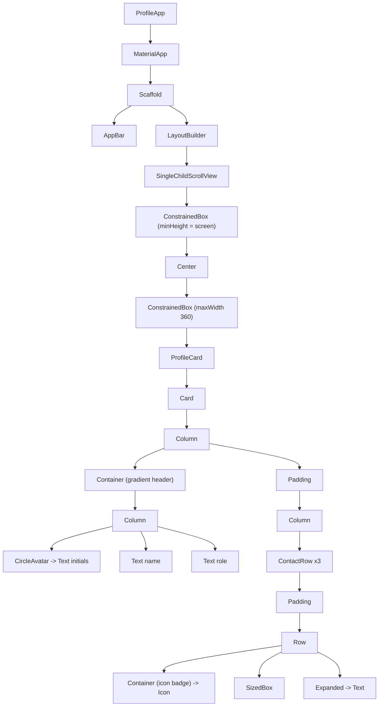

# Profile Card App (Flutter)

A single-screen Flutter app that shows a **profile card**: a circular avatar with initials, a name, a role and
three styled contact rows (email, phone, location). Built for *InternCircle - Project 01, App Development*
to practise how Flutter builds screens by nesting widgets.

<!-- After you run the app in DartPad, save your screenshot as docs/screenshot.png and uncomment:

-->

## Requirements checklist

| Requirement (from the project guide) | Where it is in `lib/main.dart` |
|---|---|
| `Column`, `Row`, `Container` and `Text` widgets | `ProfileCard` (Column, Container, Text), `ContactRow` (Row, Container, Text) |
| A circular avatar with initials | `CircleAvatar` in `ProfileCard`; initials come from `Profile.initials` |
| Styled contact rows with icons | `ContactRow` - round tinted icon badge + text |
| A layout that works on narrow screens | `ConstrainedBox(maxWidth: 360)` + `Expanded` text + `SingleChildScrollView` |
| `ContactRow` is a reusable widget | `class ContactRow extends StatelessWidget` (used 3 times) |
| Card is centred with a maximum width | `Center` + `ConstrainedBox` in `ProfileApp` |

## Widget tree



## Run it in DartPad (no install)

1. Open <https://dartpad.dev>, choose **New -> Flutter** and delete the sample code.
2. Paste the whole of [`lib/main.dart`](lib/main.dart) and press **Run**.
3. Drag the output panel narrower to see the narrow-phone layout, then take your screenshot.

To show your own details, edit `defaultProfile` near the top of the file (use real or fictional data of your own,
never someone else's private details).

## Run it locally (optional)

Requires the [Flutter SDK](https://docs.flutter.dev/get-started/install).

```bash
flutter pub get
flutter run                 # needs a platform folder, see below
```

This repository contains only `lib/`, `test/` and `pubspec.yaml`. To run on a device or emulator, generate the
platform folders once (keep a copy of `lib/main.dart` first, to be safe):

```bash
flutter create --project-name profile_card_app .
```

## Tests

```bash
flutter analyze
flutter test
```

There are 9 automated tests (unit + widget tests) covering the avatar initials logic, the card content, the reusable
`ContactRow`, centring / maximum width on a wide screen, and no-overflow behaviour on a 320 px phone and on a very
short screen. Full details, the manual checklist and the results table are in [`TEST_REPORT.md`](TEST_REPORT.md).

GitHub Actions (`.github/workflows/flutter-ci.yml`) runs analyze + tests on every push and uploads
`test_report.txt` and coverage as a downloadable artifact.

## Project structure

```
profile_card_app/
├── lib/main.dart                 # the whole app (single file so it pastes straight into DartPad)
├── test/profile_card_test.dart   # unit + widget tests
├── pubspec.yaml
├── analysis_options.yaml
├── .github/workflows/flutter-ci.yml
├── README.md
├── TEST_REPORT.md
└── docs/Profile_Card_App_Submission.pdf
```

## What is a widget?

A widget is a small, immutable description of one piece of the user interface - a piece of text, an icon, a padding,
a row - and Flutter builds a whole screen by nesting widgets inside one another in a tree.

## Notes and decisions

- **Single file:** DartPad runs one file, so all widgets live in `lib/main.dart`.
- **`const` everywhere possible** so Flutter can reuse unchanged widgets.
- **Theme colours** come from `ColorScheme.fromSeed`, so contrast stays consistent without hard-coded colours.
- **Why `Expanded` around the contact text:** long emails or addresses wrap onto a second line instead of
  causing a yellow-black overflow stripe on narrow screens.
